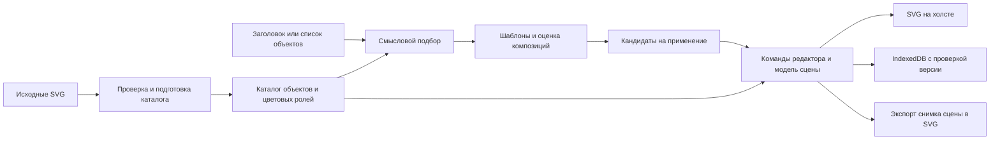

# Проект решения для тестового «Студии Очень»

Статус: согласованный план; реализация и проверка выполнены, итоговые результаты — в `../TEST_REPORT.md`. Дата: 10 ноября 2026. Ограничение: два дня.

## 1. Результат, который сдаём

Запускаемое веб-приложение для автоматической сборки композиций из библиотеки работодателя. Два входных сценария: заголовок/метафора и список объектов. После сборки композиция доступна для ручной доводки и скачивания самостоятельного редактируемого SVG.

В комплект входят исходники, инструкция запуска, краткая архитектура, описание применения AI, 2–3 готовые композиции, короткая демонстрация и отчёт о реально выполненных проверках.

Основная работа выполняется в браузере. Проекты сохраняются в этом браузерном профиле. Облачное хранение, общая редактируемая сцена и совместная работа в реальном времени не входят в первую версию. Несколько независимых посетителей могут пользоваться одним опубликованным приложением одновременно.

## 2. Требования и границы

| Требование задания | Решение | Как принимаем |
|---|---|---|
| Только элементы исходной библиотеки | Версионированный каталог разрешённых assetId, исходные геометрии не редактируются | Происхождение каждого экземпляра проверяется; в файле нет посторонних объектов |
| Ввод заголовка/метафоры | Подбор по тегам, синонимам и смысловым группам; необязательный AI-адаптер | Согласованный набор метафор + честная обработка неизвестного смысла |
| Ввод названий компонентов | Нормализация, поиск синонимов, видимые выбранные объекты | Неизвестные названия не подменяются случайными объектами |
| Автоматическая сборка | Три семейства шаблонов и оценка нескольких вариантов | Воспроизводимые, различающиеся и визуально приемлемые сцены |
| Редактирование | Перемещение, вращение, дубликат, удаление, порядок слоёв, Undo/Redo | Проверки мышью, клавиатурой и через тесты состояния |
| Разные форматы | Квадрат, горизонтальный, вертикальный, ограниченный пользовательский размер | Автоматическая адаптация всей композиции с сохранением относительных размеров |
| S/L | Переключение исходных вариантов детализации семейства | Геометрия берётся из соответствующего исходника, а не имитируется уменьшением L |
| Главный/фоновый | Переключение на соответствующий исходный вариант | Оттенки, контуры и детализация сохраняются по библиотеке |
| Палитра | Три исходных схемы + импорт JSON с назначением цветовых ролей | Полная перекраска без нарушения правил фона и объектов |
| Экспорт | Самостоятельный SVG с группами объектов и локальными defs | Открывается повторно, редактируется, не требует сети |

Не добавляем рисование новых фигур, редактирование узлов path, растягивание отдельных объектов и растровые элементы. Пользовательский импорт произвольных SVG не нужен: условие разрешает заранее подготовленную библиотеку. Палитру и файл собственного проекта импортировать можно.

## 3. Первый этап: проверка исходников

До большой работы над интерфейсом выгрузить библиотеку, сохранить оригиналы и проверить один объект, его дубль, вариант S/L и фоновый вариант.

Проверяем viewBox, фактические границы рисунка, прозрачные поля, маски, clipPath, градиенты, фильтры, CSS, размеры и идентификаторы. Устанавливаем канонические относительные размеры по исходной библиотеке, а не нормализуем каждый объект независимо до одинаковой ширины.

Контрольный результат: три исходных объекта собраны в одну сцену, один из них продублирован, палитра заменена, SVG экспортирован и снова открыт. Если появляются пропавшие маски, растр или нарушенные размеры, сначала устраняем это.

Оригиналы остаются неизменными. У подготовленных вариантов хранится связь с исходным элементом и контрольная сумма. Геометрия path и пропорции проверяются; переименование id, перенос цвета в именованные роли и упаковка в группу допустимы как техническая подготовка без перерисовки.

## 4. Архитектура

Рекомендуемый стек: React, TypeScript, Vite, нативный SVG, Dexie для IndexedDB, DOMPurify для SVG-подготовки, Vitest, fast-check и Playwright. Версии закрепляются lockfile на старте реализации. Причины выбора и первичные источники: [RESEARCH.md](RESEARCH.md).

Модули:

| Модуль | Ответственность |
|---|---|
| `catalog` | Чтение подготовленных оригиналов, варианты S/L и main/background, теги, эталонные размеры |
| `palette` | Валидация палитры, цветовые роли, перекраска без изменения геометрии |
| `semantics` | Объекты по словам/метафорам, понятная причина выбора, список нераспознанных названий |
| `composition` | Детерминированные шаблоны, общий масштаб, повороты, слои, оценка вариантов |
| `scene` | Типы, инварианты, чистые команды и история Undo/Redo |
| `editor` | Холст, выбор и перетаскивание, панели, клавиатура; без скрытой бизнес-логики в обработчиках |
| `persistence` | Очередь сохранений, сравнение версий, восстановление и конфликт двух вкладок |
| `export` | Экспорт фиксированной версии сцены, уникальные SVG-id и локальные ссылки |
| `tests` | Проверки инвариантов, UI, гонок, экспорта и пределов |

Обработчики интерфейса вызывают команды. Они не меняют исходный SVG напрямую и не хранят вторую независимую копию сцены внутри DOM.

## 5. Модель данных и неизменные правила

`AssetFamily`: стабильный id, название, синонимы/теги, эталонные размеры, точки привязки, ссылки на варианты по детализации и роли.

`AssetVariant`: familyId, S/L, main/background, локальная SVG-геометрия, viewBox, внутренние ссылки, карта цветовых ролей, версия каталога.

`Palette`: версия формата, id/название, именованные фоновые и объектные цвета, неизменяемые нейтральные роли. Фоновые цвета разрешены в объектах; объектные цвета в фоне запрещены.

`SceneDocument`: schemaVersion, documentId, catalogVersion, размер холста, детализация, paletteId/снимок палитры, общий contentScale, массив экземпляров, seed, contentRevision.

`SceneInstance`: instanceId, familyId, role, x, y, rotation. Порядок массива определяет слои. Индивидуального независимого масштаба нет: это исключает нарушение пропорций объектов относительно друг друга. Каноническая поправка размера варианта берётся только из каталога.

Запись хранилища отдельно содержит storageRevision. Версия содержимого и версия сохранённой записи не смешиваются.

Инварианты:

- Геометрии происходят только из разрешённого каталога; неизвестный id отклоняется.
- Все координаты и углы конечные; NaN, Infinity и некорректные числа не доходят до рендера.
- Масштаб всей композиции общий; относительные размеры соответствуют библиотеке.
- ID экземпляров и внутренних SVG-ресурсов уникальны. У дубликата собственные id и ссылки на них.
- Не допускаются script, event-атрибуты, foreignObject, внешние ссылки, растровые image и неподдерживаемые конструкции, нарушающие самостоятельность экспорта.
- Перекраска затрагивает объявленные роли, включая связанные градиенты; нейтральные контуры и белые участки сохраняются по правилам исходника.
- Неизвестные версии схемы/каталога не открываются с молчаливой потерей объектов.

## 6. Как собираем композицию

1. Нормализуем ввод и разрешаем названия в familyId.
2. Для метафоры используем теги и небольшой проверенный словарь смыслов: работа, обучение, фокус, идеи, связь, время и т. п. Список и примеры уточняем по реальному составу библиотеки.
3. При неопределённости показываем найденные объекты и предлагаем уточнение. Не обещаем понимание произвольной метафоры ограниченной библиотекой.
4. Выбираем главные и фоновые роли; сохраняем явно выбранные пользователем компоненты.
5. Проверяем несколько кандидатов трёх семейств: диагональ, главный объект с окружением, композиция с местом под заголовок. Последнее означает свободное место, а не добавление постороннего текстового объекта в иллюстрацию.
6. Используем общий масштаб, исходные относительные размеры, заданные повороты, контролируемые перекрытия и допустимое кадрирование. Полный запрет пересечений не подходит: в примерах перекрытия являются частью композиции.
7. Оцениваем видимость главного объекта, заполнение кадра, свободное пространство, смысловую связность и похожесть вариантов друг на друга.
8. Показываем три результата. Применение результата — одна отменяемая команда. На пустом холсте первый вариант можно применить сразу.

Одинаковые параметры и seed дают одинаковый результат. Кнопка «Ещё варианты» меняет seed. При смене формата адаптируем расположение и общий масштаб; ручную композицию можно восстановить через Undo.

Внешний AI — расширение подбора, не источник SVG. Он возвращает только разрешённые familyId и роли в проверяемой структуре. Ключ хранится на сервере; изображение и код SVG от модели не принимаются. Базовый словарь работает без сети. В двухдневный срок AI-адаптер подключаем только после прохождения SVG-экспорта и ядра редактора.

## 7. Интерфейс

Основной вариант — рабочая студия с тремя областями, спокойным светлым фоном и лиловым акцентом, согласованным с исходной библиотекой. Шрифт — читаемый системный sans-serif. Холст визуально отделён от интерфейса; графика получает больше места, чем служебные панели.

- **Сверху:** название проекта, Undo/Redo, реальное состояние сохранения, основной экспорт SVG.
- **Слева:** вкладки «Собрать», «Объекты», «Слои». В сборке — переключатель «По смыслу / По объектам», поле ввода, 2–3 примера и одна основная кнопка.
- **В центре:** холст, выделение целого объекта и ручка вращения, масштаб просмотра. Под холстом — три миниатюры вариантов.
- **Справа:** параметры композиции, а при выделении — свойства объекта. Формат холста, S/L, палитра и импорт палитры доступны без поиска по меню.
- **Для объекта:** главный/фоновый, позиция, угол, дубликат, удаление и порядок слоя. Нет ручек произвольного растягивания.

Главный пользовательский путь: ввод → варианты → выбор → небольшая доводка → экспорт. Режим «По объектам» позволяет работать без понимания термина «метафора».

Предусмотреть состояния: пустой проект, загрузка каталога, сборка с отменой, неизвестный объект, неподходящая палитра, ошибка экспорта, несохранённые изменения, конфликт вкладок, восстановленный проект, недоступность AI.

У загрузки/ошибки есть понятное следующее действие. Последняя рабочая сцена остаётся видимой и доступной для экспорта. Для удаления и изменения предусмотрен Undo. Горячие клавиши редактора не перехватывают ввод в текстовые поля.

При узкой ширине правая панель переходит в раскрываемый блок; обязательные кнопки остаются доступными. Приоритет приёмки — desktop Chrome; Firefox проверяется основным сценарием. На ширинах 1440, 1280, 1024, 768 и 390 px не должно быть наложений или недоступных действий.

Концептуальный макет в чате показывает компоновку и взаимодействия. Условные значки в нём не являются библиотекой или итоговыми иллюстрациями.

## 8. Сохранение, гонки и изоляция

**Независимые посетители.** Каталог доступен только для чтения; сцены живут в независимых браузерных хранилищах. Это не система аккаунтов: люди, использующие один браузерный профиль, могут видеть его локальные проекты. Сервер общего документа отсутствует.

**Две вкладки одного проекта.** Каждая знает storageRevision, с которой начала запись. В одной readwrite-транзакции читаем текущую версию, сравниваем ожидаемую и записываем следующую. При несовпадении не перезаписываем чужие изменения: останавливаем автосохранение, сохраняем рабочую копию в памяти и предлагаем создать отдельный проект или открыть актуальную версию. BroadcastChannel ускоряет предупреждение, но не служит источником истины.

**Последовательные сохранения.** На документ — одна очередь, частые изменения объединяются. Успех старого сохранения не переводит более новую сцену в состояние «Сохранено». Версия помечается сохранённой только после завершения транзакции.

**Сборка/перекраска.** У задачи есть generationId, baseContentRevision, catalogVersion и версия палитры. При новом запросе предыдущая задача отменяется; результат дополнительно проверяется по этим полям. Изменение сцены/палитры, Undo или смена документа делают несовместимый результат неприменимым.

**Экспорт во время правки.** Экспорт берёт неизменяемый снимок сцены и разрешённых ресурсов. Имя файла связано с этим снимком; в файл не попадает половина старой и половина новой палитры.

**Drag и вращение.** Pointer capture, обработка pointercancel/lostpointercapture/blur. Промежуточное движение — предпросмотр; завершённый жест — одна команда истории. Отменённый жест возвращает согласованное состояние.

**Вычисления.** Начинаем с чистых ограниченных функций в основном потоке. Worker добавляем только если реальные SVG/измерения показывают блокировки. Если Worker используется, у него нет общего изменяемого буфера каталога; сообщения проверяются по jobId и версиям. Worker-error не уничтожает сцену.

**AI-сервер, если включён.** Отдельное состояние на каждый HTTP-запрос, таймаут, валидация ответа, предел параллельных запросов и ограниченная очередь. Никакого общего `currentScene` или общего временного имени файла. На открытом хостинге AI-вызовы включаются только с установленными квотами/защитой доступа. Лимитер одного процесса нельзя считать общим для нескольких реплик.

## 9. Предельные ситуации

Начальные защитные пределы, уточняемые после аудита библиотеки: до 50 экземпляров, сторона холста 128–4096 px, ввод до 1000 символов, JSON палитры до 32 КиБ, проект до 2 МиБ. Дополнительно ограничиваем суммарную сложность SVG по числу узлов, а не только количество объектов.

При превышении лимита — конкретная ошибка до изменения сцены. Для неизвестного размера/объекта/палитры прежний документ сохраняется.

Обрабатываем недоступное хранилище и QuotaExceededError: явное состояние «Не сохранено» и скачивание файла проекта. Не заявляем гарантированное сохранение последних действий при аварийном завершении процесса. После перезапуска восстанавливаем последнюю подтверждённую запись.

Временные Blob URL освобождаются после использования, отменённые задачи и слушатели убираются, история Undo ограничена по количеству и объёму. Ошибки не логируют ключи, пароли и необработанные пользовательские данные.

## 10. План на два дня

Это рабочая оценка примерно 16–20 часов с резервом, а не обещание точного времени. Разработка приложения пока не начата.

| Блок | Время | Проверяемый результат |
|---|---:|---|
| День 1: исходники и риск SVG | 2–3 ч | Каталог, размеры, роли, рабочий экспорт трёх объектов и дубликата |
| День 1: ядро сцены и сборка | 2–3 ч | Чистая модель, шаблоны, ввод объектов/метафор, три кандидата |
| День 1: рабочий интерфейс | 3–4 ч | Редактирование, слои, S/L, формат, палитры, SVG |
| День 2: сохранение и устойчивость | 2–3 ч | Автосохранение, восстановление, защита от устаревших задач/двух вкладок |
| День 2: проверки и исправления | 3–4 ч | Матрица критических сценариев, случайные команды, экстремальные данные, проверка файлов |
| День 2: сдача и резерв | 2–3 ч | Визуальная доводка, 2–3 примера, README, демонстрация и отчёт |

После первого блока пересматриваем оценку по сложности настоящих SVG. После дня 1 должен существовать полный путь «ввод → редактирование → экспорт»; украшение интерфейса не откладывает проверку экспорта.

В резерв уходят: дополнительный AI-провайдер, анимации интерфейса, облачные проекты и дополнительные шаблоны. Все обязательные требования остаются в первой версии. При риске срыва сначала уменьшаем необязательный объём и сообщаем о фактическом состоянии.

## 11. Условия готовности

- Проверены оба сценария ввода, операции редактора, S/L, роли, три исходные палитры и импорт собственной.
- Сцены сохраняют происхождение объектов, относительные размеры и векторность.
- Три примера в разных форматах экспортированы, заново открыты и проверены в независимом редакторе; в отчёте названы реальные инструменты и результаты.
- Все P0/P1 проверки из [TEST_MATRIX.md](TEST_MATRIX.md) прошли либо явно отмечены как блокирующие сдачу. Непроверенные пункты не называются пройденными.
- Гонки проверены управляемыми задержками/барьерами, а не только быстрыми кликами вручную.
- Проверки типов, сборка и выбранные автоматические тесты проходят. Известные ограничения отражены в README.
- Новому проверяющему достаточно инструкции запуска; для базового сценария не нужен внешний AI-ключ.
